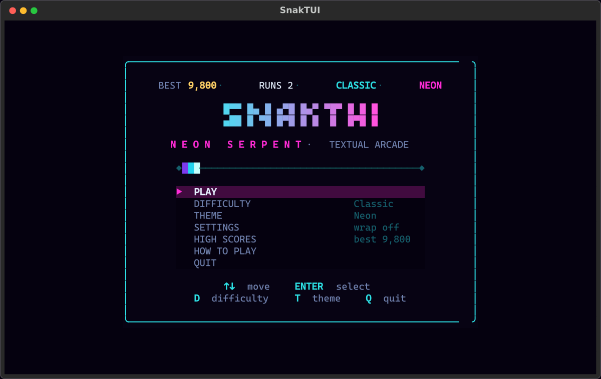
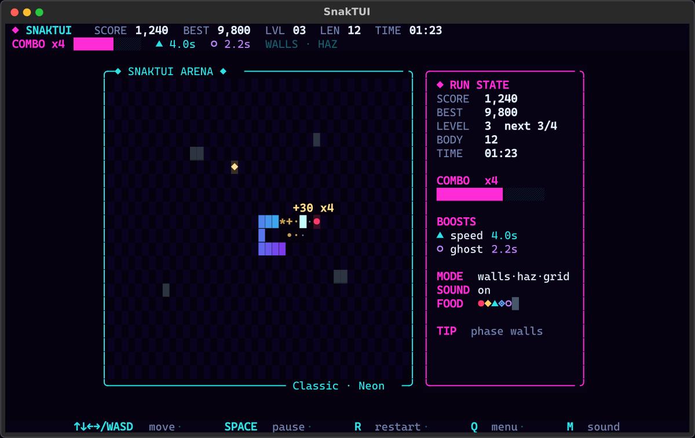
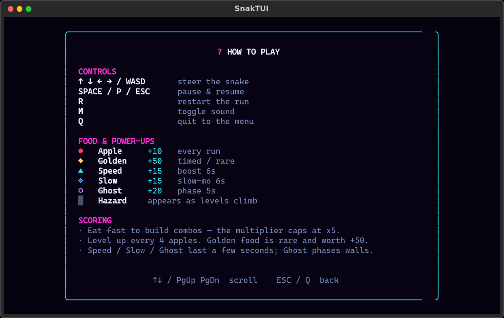
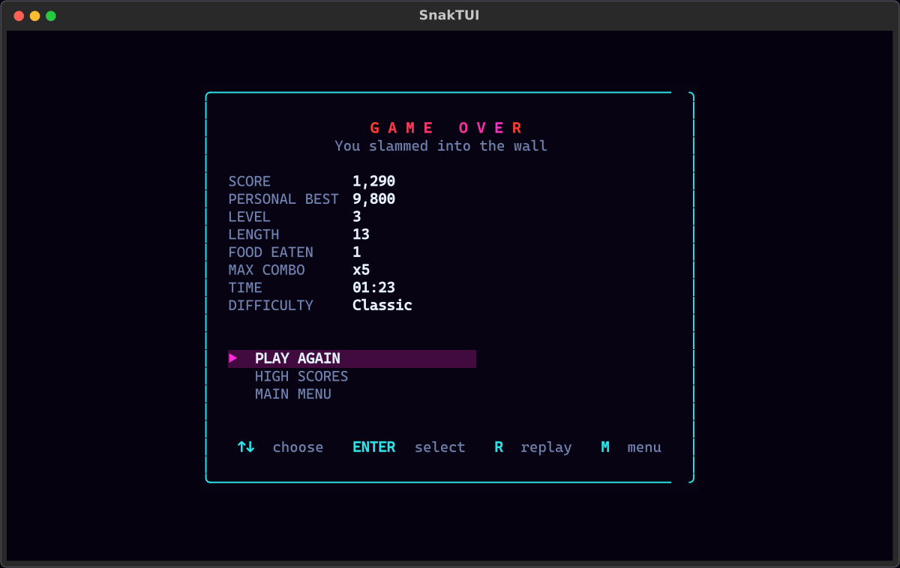

# SnakTUI

A feature-rich, visually striking modern **Snake** game for your terminal,
built with **Python** and **[Textual](https://textual.textualize.io/)**.

Neon gradients, particle bursts, combos, power-ups, hazards, eleven themes and a
persistent local leaderboard — all rendered in pure Unicode blocks. No images,
no browser, no GPU.

<p align="center">
  <a href="https://github.com/Mark44928/SnakTUI/actions/workflows/ci.yml"></a>
  
  
  
  
</p>



## Contents

- [Highlights](#highlights)
- [Installation](#installation)
- [Controls](#controls)
- [Food & scoring](#food--scoring)
- [Settings & data](#settings--data)
- [Project layout](#project-layout)
- [Development](#development)
- [Screens](#screens)
- [Troubleshooting](#troubleshooting)
- [Uninstall](#uninstall)
- [License](#license)

## Highlights

- **Fast, modern arena** — gradient snake, glowing food, particle bursts,
  floating score popups and screen shake on death.
- **Combo scoring** — eat quickly to stack a multiplier up to **x5**.
- **Power-ups** — Speed, Slow, Ghost (phase through walls, hazards and
  yourself), Frenzy (double points) and Magnet (pulls apples toward you).
- **Special food** — rare golden apples, timed spawns that blink before they
  expire.
- **Progressive difficulty** — level up every 4 apples; speed climbs and
  hazards appear as you survive.
- **Eleven themes** — five hand-tuned palettes (Neon, Amber, Matrix, Ice,
  Candy) and six real terminal schemes with their official colors: Dracula,
  Nord, Gruvbox, Catppuccin Mocha, Tokyo Night and Solarized Dark.
- **Three difficulties** — Chill, Classic and Insane.
- **Persistent settings and top-10 leaderboard** stored as plain JSON.
- **Theme picker** — press `P` (or Settings → Browse themes) for a full list
  with five-block swatches, a live arena preview, and Esc to cancel.
- **Responsive layout** — sidebar appears on wide terminals and hides on
  narrow ones; the arena adapts to your terminal size.
- **Keyboard-first** — full menu, settings, help and high-score screens.



## Installation

Requires **Python 3.10+** and a terminal with Unicode and truecolor support.
A minimum of **80×24** is recommended; **100×30** or larger looks best.

### From GitHub (recommended)

```bash
pipx install git+https://github.com/Mark44928/SnakTUI
snaktui
```

### From a clone

```bash
git clone https://github.com/Mark44928/SnakTUI
cd SnakTUI
python -m venv .venv
. .venv/bin/activate
pip install -e .
python -m snaktui
```

If `textual` is already installed system-wide, the venv is optional —
`python -m snaktui` works directly, and `--version` prints the release.

### Termux (Android)

```bash
pkg install python git
git clone https://github.com/Mark44928/SnakTUI
cd SnakTUI
python -m venv .venv
. .venv/bin/activate
pip install -e .
python -m snaktui
```

On Termux, if `pip install ruff` tries to build from source, install the
prebuilt package instead: `pkg install ruff`.

### Uninstall

```bash
pipx uninstall snaktui        # if installed with pipx
pip uninstall snaktui         # if installed with pip
```

Saved settings and scores live outside the package; remove them only if you
want a clean slate:

```bash
rm -rf "${XDG_DATA_HOME:-$HOME/.local/share}/snaktui"
```

## Controls

### Menu

| Key | Action |
| --- | --- |
| `↑` `↓` / `K` `J` | Move selection |
| `Enter` / `Space` | Activate |
| `D` | Cycle difficulty |
| `T` | Cycle theme |
| `P` | Theme picker (live preview) |
| `S` | Settings |
| `H` | How to play |
| `G` / `L` | High scores |
| `Q` | Quit |

### Game

| Key | Action |
| --- | --- |
| `↑` `↓` `←` `→` / `WASD` | Steer |
| `Space` / `P` / `Esc` | Pause / resume |
| `R` | Restart run |
| `M` | Toggle sound |
| `Q` | Back to menu |

### Settings

The header shows a live five-block swatch of the active palette (accent,
accent2, golden, speed, danger) so you can see a theme before switching.
**Browse themes** opens the full picker: `↑↓` previews live, `←→` jumps three,
`Enter` applies, `Esc` restores the theme you started with.

| Key | Action |
| --- | --- |
| `↑` `↓` | Move |
| `←` `→` | Change value |
| `Enter` / `Space` | Toggle |
| `Esc` / `Q` | Back |

## Food & scoring

| Food | Glyph | Points | Effect |
| --- | --- | --- | --- |
| Apple | `●` | +10 | Always present |
| Golden | `◆` | +50 | Rare, timed |
| Speed | `▲` | +15 | Faster for 6s |
| Slow | `◈` | +15 | Slow-mo for 6s |
| Ghost | `○` | +20 | Phase through walls, hazards and yourself for 5s |
| Frenzy | `✦` | +25 | Double points for 6s |
| Magnet | `✚` | +20 | Drags apples toward the snake for 8s |
| Hazard | `▓` | — | Deadly obstacle |

Every apple eaten within the combo window raises the multiplier, capped at
**x5**. Level up every **4** apples. The multiplier applies to all food.

The HUD tracks live effect timers, and on wider terminals a **NEXT** bar shows
progress toward the next level.

## Settings & data

Settings and scores live in a single JSON document:

1. `$SNAKTUI_DATA_DIR/state.json` when the variable is set.
2. `$XDG_DATA_HOME/snaktui/state.json` when `XDG_DATA_HOME` is set.
3. `~/.local/share/snaktui/state.json` otherwise.

Scores are sorted, capped at ten entries, and saved atomically. A corrupt or
unreadable file is ignored instead of crashing the game.

## Project layout

```
snaktui/
├── __main__.py      # `python -m snaktui`
├── app.py           # App shell, adaptive sizing, navigation
├── board.py         # Arena renderer (Rich Text widget)
├── game.py          # Pure simulation — no Textual imports
├── models.py        # Dataclasses, enums, difficulty presets
├── screens.py       # Menu, game, game over, settings, scores, help
├── storage.py       # Atomic JSON settings + leaderboard
├── styles.tcss      # Textual CSS
└── theme.py         # Palettes and color blending
```

The simulation (`game.py` + `models.py`) is deliberately UI-free so it can be
unit-tested and reused. Rendering lives in `board.py`; screen composition and
input handling live in `screens.py`.

## Development

```bash
python -m venv .venv
. .venv/bin/activate
pip install -e ".[dev]"

ruff check .
pytest -q
```

Headless smoke tests drive the real Textual app with `App.run_test`, so they
work over SSH and in CI without a TTY.

## Screens





## Troubleshooting

- **No colors or blocky glyphs** — use a terminal with Unicode and truecolor
  support, and a font with good box-drawing coverage. Try `TERM=xterm-256color`.
- **Layout looks cramped** — the game wants at least **80×24**; **100×30** or
  larger is better. The sidebar hides automatically on narrow terminals.
- **`ruff` builds from source on Termux** — install the prebuilt package with
  `pkg install ruff` instead of `pip install ruff`.
- **Over SSH** — make sure the session uses a UTF-8 locale, e.g.
  `export LANG=en_US.UTF-8`.
- **Reset settings or scores** — delete
  `${XDG_DATA_HOME:-$HOME/.local/share}/snaktui/state.json`.
- **Textual errors after an upgrade** — update it with
  `python -m pip install -U textual`.

## Contributing

PRs welcome — see [CONTRIBUTING.md](CONTRIBUTING.md). All contributors follow
the [Code of Conduct](CODE_OF_CONDUCT.md).


## 🛠️ More from Mark44928

Tiny, dependency-free tools from the same family:

- [plusafetch](https://github.com/Mark44928/plusafetch) — C++23 fetch for Termux — ~23 ms, zero subprocesses on the default path
- [Plusalator](https://github.com/Mark44928/Plusalator) — C++17 calculator REPL — Qalculate-flavored, ghost autosuggest, 18 themes
- [GrubBlastersHTML](https://github.com/Mark44928/GrubBlastersHTML) — Worms-style artillery in one HTML file — 70 weapons, fully destructible terrain
- [Easy-Termux-Package-Manager](https://github.com/Mark44928/Easy-Termux-Package-Manager) — fzf-driven package manager for Termux — snapshots, audit, 183 tests
- [NoNameOS](https://github.com/Mark44928/NoNameOS) — OS simulation in a single C++17 file — virtual FS, real shell
- [Greenit](https://github.com/Mark44928/Greenit) — green-injected theme family — dark + light, single palette.json
- [CalculaHTML](https://github.com/Mark44928/CalculaHTML) — static HTML calculator — 15 themes + System mode, zero deps
- [android12-fastfetch](https://github.com/Mark44928/android12-fastfetch) — fastfetch config for Android 12 + native X11 Termux desktops
- [Anti-bloatware-list-for-Android-TV-Boxes-and-Sticks-for-rooted](https://github.com/Mark44928/Anti-bloatware-list-for-Android-TV-Boxes-and-Sticks-for-rooted) — ADB debloat for rooted Android 9+ TV sticks & boxes
- [Android9-audios](https://github.com/Mark44928/Android9-audios) — 217 stock Android 9 system sounds + per-file SHA-256

## License

MIT © 2026 SnakTUI Contributors. See [LICENSE](LICENSE).
