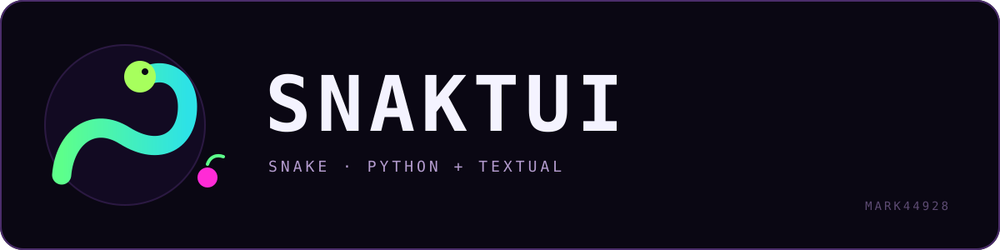
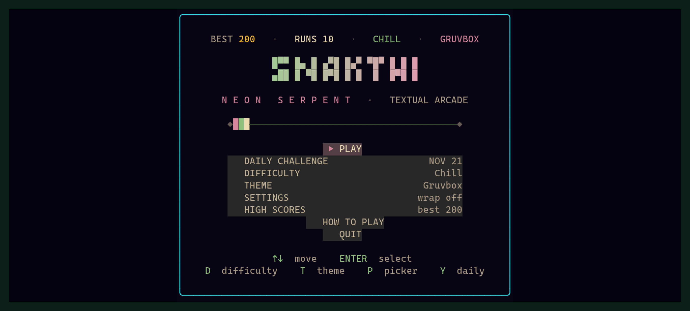
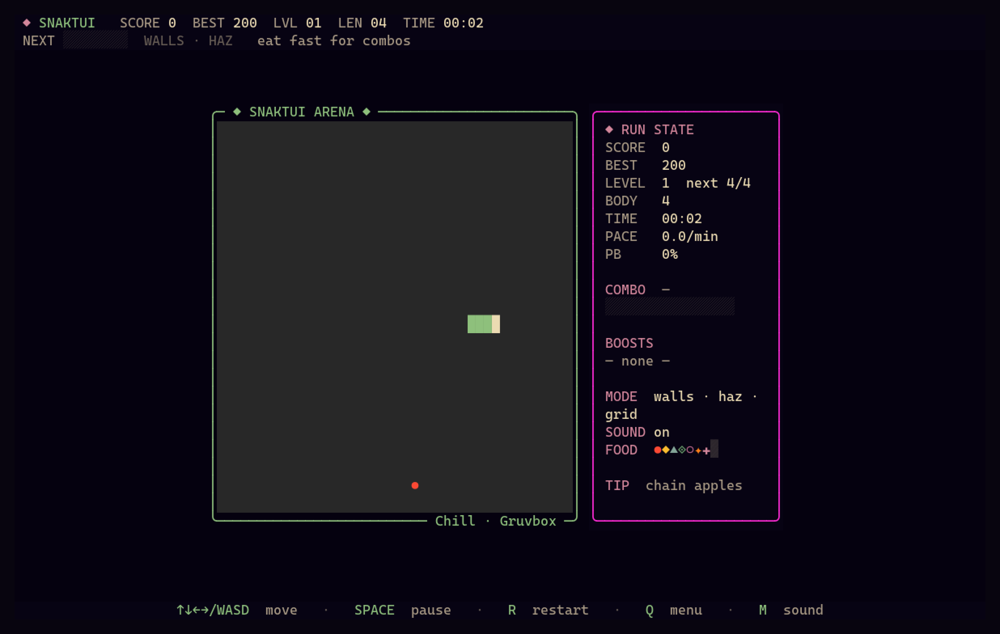
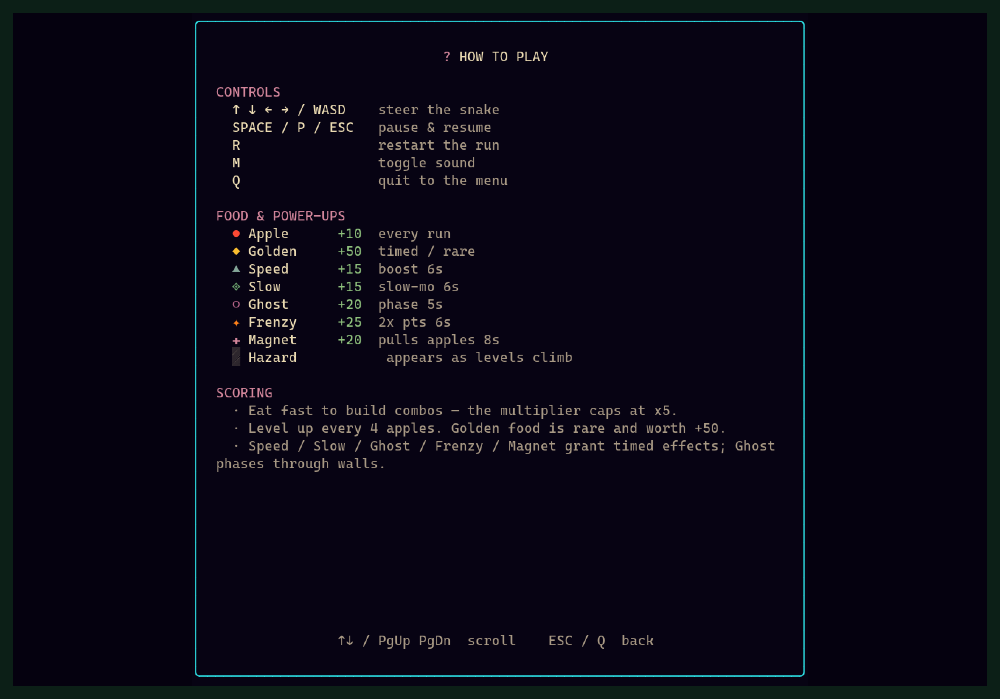
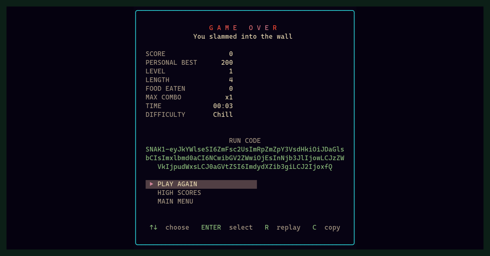

# SnakTUI

<p align="center"></p>

A **Snake** game for your terminal,
built with **Python** and **[Textual](https://textual.textualize.io/)**.

Neon gradients, particle bursts, combos, power-ups, hazards, fourteen themes and a
persistent local leaderboard — all rendered in pure Unicode blocks. The terminal edition needs no images, browser or GPU; an optional external host can serve the real app to a browser.

<p align="center">
  <a href="https://github.com/Mark44928/SnakTUI/actions/workflows/ci.yml"></a>
  
  
  
  
</p>



## Contents

- [Browser mode](#browser-mode-real-textual-app)
- [Highlights](#highlights)
- [Installation](#installation)
- [Controls](#controls)
- [Food & scoring](#food--scoring)
- [Settings & data](#settings--data)
- [Project layout](#project-layout)
- [Development](#development)
- [Screens](#screens)
- [Troubleshooting](#troubleshooting)
- [Uninstall](#uninstall)
- [License](#license)

## Highlights

- **Fast arena** — gradient snake, glowing food, particle bursts,
  floating score popups and screen shake on death.
- **Combo scoring** — eat quickly to stack a multiplier up to **x5**.
- **Power-ups** — Speed, Slow, Ghost (phase through walls, hazards and
  yourself), Frenzy (double points) and Magnet (pulls apples toward you).
- **Special food** — rare golden apples, timed spawns that blink before they
  expire.
- **Progressive difficulty** — level up every 4 apples; speed climbs and
  hazards appear as you survive.
- **Fourteen themes** — five hand-tuned palettes (Neon, Amber, Matrix, Ice,
  Candy), six real terminal schemes with their official colors (Dracula, Nord,
  Gruvbox, Catppuccin Mocha, Tokyo Night and Solarized Dark), plus Greenit,
  Bluney and Yellen from the family palettes.
- **Three difficulties** — Chill, Classic and Insane.
- **Daily Challenge** — a date-seeded Classic run (fixed walls + hazards) so
  everyone gets the same arena sequence; results are tagged `DAILY` in the
  leaderboard and show the shareable seed on the results screen.
- **Run codes** — every game over screen includes a `SNAK1-…` code and `C`
  copies it to the terminal clipboard for sharing or later parsing.
- **Run-code import** — `snaktui --import-run SNAK1-…` stores a shared run in
  the local leaderboard; `--export-latest` prints the top saved run's code.
- **Ghost racing** — your best matching run leaves a dim trail and ghost head in
  the next arena; Daily ghosts only appear on the same seed.
- **Achievements** — the Hall of Fame derives badges from your saved runs:
  score milestones, long snakes, run counts, Daily streaks and Insane wins.
- **Real browser mode** — the same Textual app can be served with `textual-serve` from an external Python host; no browser-specific game clone.
- **Persistent settings and top-10 leaderboard** stored as plain JSON.
- **Palette editor** — Settings → Edit palette; use arrows to recolor, `S` saves
  it as a custom theme, and it persists in `state.json`
- **Theme picker** — press `P` (or Settings → Browse themes) for a full list
  with five-block swatches, a live arena preview, and Esc to cancel.
- **Low graphics mode** — one Settings toggle removes gradients, flash, pulses,
  particles and score pop-ups for maximum terminal throughput.
- **Accessibility mode** — letter-coded food (A/G/S/W/H/F/M), high-contrast
  glyphs, and no flashing or food pulse.
- **Responsive layout** — sidebar appears on wide terminals and hides on
  narrow ones; the arena adapts to your terminal size.
- **Keyboard-first** — full menu, settings, help and high-score screens.



## Browser mode (real Textual app)

SnakTUI can run the exact Textual application in a browser through [`textual-serve`](https://github.com/Textualize/textual-serve). It is not a JavaScript clone, and it cannot be hosted on GitHub Pages: a persistent external Python process is required.

Run it on any Python host (not required on your tablet):

```bash
pip install ".[web]"
snaktui-web --host 127.0.0.1 --port 8000
# open http://127.0.0.1:8000
```

For an external deployment, the included `Dockerfile` and `render.yaml` run the same app on [Render](https://render.com) or any container host. That host stays available independently of your tablet:

```bash
docker build -t snaktui-web .
docker run --rm -p 8000:8000 snaktui-web
```

Browsing the hosted page starts an isolated SnakTUI process. Scores are container-local unless the host provides persistent storage; treat the hosted build as a demo, not a shared leaderboard. The SSH/Telnet route is deliberately not included.

## Installation

Requires **Python 3.10+** and a terminal with Unicode and truecolor support.
A minimum of **80×24** is recommended; **100×30** or larger looks best.

### Installer (isolated venv)

```bash
./install.sh                 # fzf menu when available
./install.sh --no-menu       # non-interactive
./install.sh --uninstall     # remove launcher + managed venv
```

It installs into `$XDG_DATA_HOME/snaktui/venv`, links a launcher into
`$PREFIX/bin` on Termux or `~/.local/bin` elsewhere, and never installs fzf.

### From GitHub (recommended)

```bash
pipx install git+https://github.com/Mark44928/SnakTUI
snaktui
```

### From a clone

```bash
git clone https://github.com/Mark44928/SnakTUI
cd SnakTUI
python -m venv .venv
. .venv/bin/activate
pip install -e .
python -m snaktui
```

If `textual` is already installed system-wide, the venv is optional —
`python -m snaktui` works directly, and `--version` prints the release.
You can also import a shared run code without launching the TUI:

```bash
snaktui --import-run 'SNAK1-…'
snaktui --export-latest   # print the highest saved run as a share code
```

### Termux (Android)

```bash
pkg install python git
git clone https://github.com/Mark44928/SnakTUI
cd SnakTUI
python -m venv .venv
. .venv/bin/activate
pip install -e .
python -m snaktui
```

On Termux, if `pip install ruff` tries to build from source, install the
prebuilt package instead: `pkg install ruff`.

### Uninstall

```bash
pipx uninstall snaktui        # if installed with pipx
pip uninstall snaktui         # if installed with pip
```

Saved settings and scores live outside the package; remove them only if you
want a clean slate:

```bash
rm -rf "${XDG_DATA_HOME:-$HOME/.local/share}/snaktui"
```

## Controls

### Menu

| Key | Action |
| --- | --- |
| `↑` `↓` / `K` `J` | Move selection |
| `Enter` / `Space` | Activate |
| `D` | Cycle difficulty |
| `T` | Cycle theme |
| `P` | Theme picker (live preview) |
| `Y` | Daily Challenge |
| `S` | Settings |
| `H` | How to play |
| `G` / `L` | High scores |
| `Q` | Quit |

### Game

| Key | Action |
| --- | --- |
| `↑` `↓` `←` `→` / `WASD` | Steer |
| `Space` / `P` / `Esc` | Pause / resume |
| `R` | Restart run |
| `M` | Toggle sound |
| `Q` | Back to menu |

### Game over

| Key | Action |
| --- | --- |
| `R` | Play again (same Daily seed when applicable) |
| `C` | Copy the `SNAK1-…` run code |
| `M` / `Esc` | Main menu |

### Daily Challenge

Press `Y` on the menu (or choose **Daily Challenge**) for today's deterministic
run. The board is seeded from the local date and always uses Classic difficulty,
walls and hazards, so the spawn sequence is stable for the day. Daily scores
carry a `DAILY` tag in the leaderboard, and the results screen shows the seed
(`YYYYMMDD`) for sharing. Restarting or pressing **Play Again** keeps the same
daily seed.

### Settings

The header shows a live five-block swatch of the active palette (accent,
accent2, golden, speed, danger) so you can see a theme before switching.
**Browse themes** opens the full picker: `↑↓` previews live, `←→` jumps three,
`Enter` applies, `Esc` restores the theme you started with.
**Low graphics** strips the snake gradient, death flash, food pulse, halo and
every particle/pop-up, and uses one flat background — a big win on slow
terminals or remote SSH sessions.

| Key | Action |
| --- | --- |
| `↑` `↓` | Move |
| `←` `→` | Change value |
| `Enter` / `Space` | Toggle |
| `Esc` / `Q` | Back |

## Food & scoring

| Food | Glyph | Points | Effect |
| --- | --- | --- | --- |
| Apple | `●` | +10 | Always present |
| Golden | `◆` | +50 | Rare, timed |
| Speed | `▲` | +15 | Faster for 6s |
| Slow | `◈` | +15 | Slow-mo for 6s |
| Ghost | `○` | +20 | Phase through walls, hazards and yourself for 5s |
| Frenzy | `✦` | +25 | Double points for 6s |
| Magnet | `✚` | +20 | Drags apples toward the snake for 8s |
| Hazard | `▓` | — | Deadly obstacle |

Every apple eaten within the combo window raises the multiplier, capped at
**x5**. Level up every **4** apples. The multiplier applies to all food.

The HUD tracks live effect timers, and on wider terminals a **NEXT** bar shows
progress toward the next level.

## Settings & data

Settings and scores live in a single JSON document:

1. `$SNAKTUI_DATA_DIR/state.json` when the variable is set.
2. `$XDG_DATA_HOME/snaktui/state.json` when `XDG_DATA_HOME` is set.
3. `~/.local/share/snaktui/state.json` otherwise.

Scores are sorted, capped at ten entries, and saved atomically. A corrupt or
unreadable file is ignored instead of crashing the game. Settings include the
arena size (Auto / Small / Medium / Large) — Auto fits the arena to your
terminal, the others cap it at 24×12, 32×16 or 40×20 cells.

## Project layout

```
snaktui/
├── __main__.py      # `python -m snaktui`
├── app.py           # App shell, adaptive sizing, navigation
├── board.py         # Arena renderer (Rich Text widget)
├── game.py          # Pure simulation — no Textual imports
├── models.py        # Dataclasses, enums, difficulty presets
├── screens.py       # Menu, game, game over, settings, scores, help
├── storage.py       # Atomic JSON settings + leaderboard
├── styles.tcss      # Textual CSS
└── theme.py         # Palettes and color blending
```

The simulation (`game.py` + `models.py`) is deliberately UI-free so it can be
unit-tested and reused. Rendering lives in `board.py`; screen composition and
input handling live in `screens.py`.

## Development

```bash
python -m venv .venv
. .venv/bin/activate
pip install -e ".[dev]"

ruff check .
pytest -q
```

Headless smoke tests drive the real Textual app with `App.run_test`, so they
work over SSH and in CI without a TTY.

## Screens





## Troubleshooting

- **No colors or blocky glyphs** — use a terminal with Unicode and truecolor
  support, and a font with good box-drawing coverage. Try `TERM=xterm-256color`.
- **Layout looks cramped** — the game wants at least **80×24**; **100×30** or
  larger is better. The sidebar hides automatically on narrow terminals.
- **`ruff` builds from source on Termux** — install the prebuilt package with
  `pkg install ruff` instead of `pip install ruff`.
- **Over SSH** — make sure the session uses a UTF-8 locale, e.g.
  `export LANG=en_US.UTF-8`.
- **Reset settings or scores** — delete
  `${XDG_DATA_HOME:-$HOME/.local/share}/snaktui/state.json`.
- **Textual errors after an upgrade** — update it with
  `python -m pip install -U textual`.

## Contributing

PRs welcome — see [CONTRIBUTING.md](CONTRIBUTING.md). All contributors follow
the [Code of Conduct](CODE_OF_CONDUCT.md).


## 🛠️ More from Mark44928

Tiny, dependency-free tools from the same family:

- [Pythonator](https://github.com/Mark44928/Pythonator) — Python rewrite of Plusalator — stdlib-only, `--eval`/`--json`
- [Solvamath](https://github.com/Mark44928/Solvamath) — terminal math puzzle game — seven puzzle types, daily seed, achievements
- [Bluney](https://github.com/Mark44928/Bluney) — blue-injected theme family — dark + light, single palette.json
- [Fluffless Prompt](https://github.com/Mark44928/FlufflessPrompt) — quiet Oh My Zsh theme — Git state, exit codes, clock
- [Weatui](https://github.com/Mark44928/Weatui) — friendly Open-Meteo weather TUI — saved cities, forecasts, no API key
- [Yellen](https://github.com/Mark44928/Yellen) — golden-yellow theme family — dark + light, single palette.json
- [Mark44928](https://github.com/Mark44928) — profile and project index
- [plusafetch](https://github.com/Mark44928/plusafetch) — C++23 fetch for Termux — ~23 ms, zero subprocesses on the default path
- [Plusalator](https://github.com/Mark44928/Plusalator) — C++17 calculator REPL — Qalculate-flavored, ghost autosuggest, 19 themes
- [GrubBlastersHTML](https://github.com/Mark44928/GrubBlastersHTML) — Turn-based artillery in one HTML file — 73 weapons, fully destructible terrain
- [Easy-Termux-Package-Manager](https://github.com/Mark44928/Easy-Termux-Package-Manager) — fzf-driven package manager for Termux — snapshots, audit, 194 tests
- [NoNameOS](https://github.com/Mark44928/NoNameOS) — OS simulation in a single C++17 file — virtual FS, real shell
- [Greenit](https://github.com/Mark44928/Greenit) — green-injected theme family — dark + light, single palette.json
- [CalculaHTML](https://github.com/Mark44928/CalculaHTML) — static HTML calculator — 16 themes + System mode, zero deps
- [android12-fastfetch](https://github.com/Mark44928/android12-fastfetch) — fastfetch config for Android 12 + native X11 Termux desktops
- [debloat-android-tv](https://github.com/Mark44928/debloat-android-tv) — ADB debloat for rooted Android 9+ TV sticks & boxes
- [Android9-audios](https://github.com/Mark44928/Android9-audios) — 217 stock Android 9 system sounds + per-file SHA-256

## License

MIT © 2026 SnakTUI Contributors. See [LICENSE](LICENSE).
